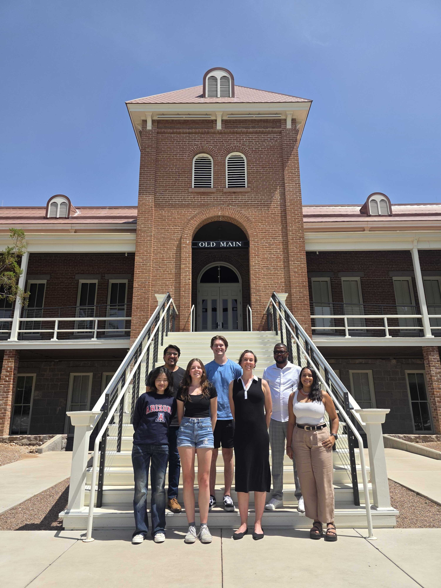

# Research

{:class="float-right"}{:height='500'}

We are broadly interested in scale interactions in the atmosphere and how best to represent these in weather and climate models in order to build water and energy resilience in arid regions. We use laboratory experiments to constrain small-scale parameters, such as ice-nucleating efficiency of different particles or ice crystal growth rates, and high-resolution models to understand the effect of these parameters on large-scale variables of interest, such as surface temperatures or rainfall rates. Some themes of interest include how increasing aridity in the Southwest may feedback on rainfall patterns or affect solar energy output and how the efficiency of precipitation formation may change as the atmosphere warms.

# Latest News

&nbsp;

| Date | News |
|:-----|:-----|
| 5 October 2026 | Edgardo is in Florianópolis, Brazil on a student travel grant to present at the [5th Advancement of POLarimetric Observations Workshop](https://apolo.loa.univ-lille.fr/).
| 18 September 2026 | Thabo's [second first-author paper](https://acp.copernicus.org/articles/26/13157/2026/acp-26-13157-2026.pdf) was published in Atmospheric Chemistry \& Physics, quantifying precipitation efficiency from satellite-based convective tracking.
| 15 August 2026 | Congratulations to Juliana on her scholarship from the [Southern Arizona Environmental Management Society Inc.](https://saems.org/scholarships/)
| 10 August 2026 | Welcome to Yerim Seok, our group's newest PhD student!
| 27 July 2026 | Sylvia led a collaborative study on utility of volume rendering and topological data analysis for cloud research, accepted in the [Bulletin of the American Meteorological Society](https://journals.ametsoc.org/view/journals/bams/aop/BAMS-D-25-0055.1/BAMS-D-25-0055.1.xml?tab_body=pdf).
| 6 July 2026 | Edgardo is in Boulder, CO for NCAR's CESM Tutorial this week.
| 8 June 2026 | Sylvia is in Telluride, CO for a workshop on Aerosols and Clouds: Connections from the Laboratory to the Field to the Globe.
| 18 May 2026 | Ashlynne is in Norman, OK for the DOE's ARM Big Data Summer School.
| 30 April 2026 | Thabo was accepted in the 2026-2027 cohort of [Carsons Scholars](https://carson.arizona.edu/person/thabo-makgoale)!
| 15 April 2026 | Sylvia is visiting the Department of Atmospheric Sciences at the University of Utah to give a seminar.
| 3 February 2026 | Juliana is flying to King George Island, Antarctica to help maintain the measurement station of the Chilean Antarctic Institute (INACH) for the next four weeks! |
| 26 January 2026 | Juliana is in Houston for the American Meteorological Society meeting and will give a talk on her work studying links of aerosol extreme events and heat over the Southwest. |
